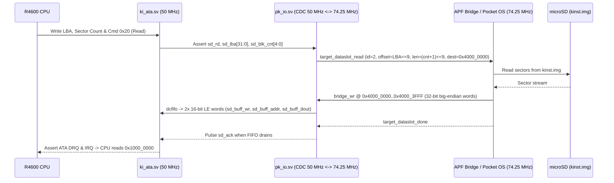
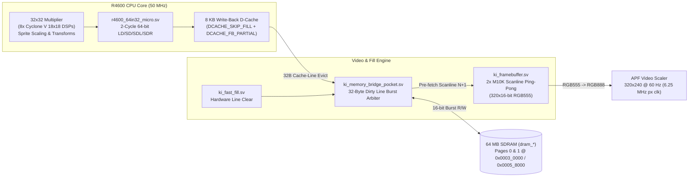

# LittleInstinct

<p align="center">
  
</p>

Analogue Pocket port of the Killer Instinct arcade core
([MiSTer-devel/Arcade-KillerInstinct_MiSTer](https://github.com/MiSTer-devel/Arcade-KillerInstinct_MiSTer)).

Covers **Killer Instinct (1994)** and **Killer Instinct 2 (1996)** — Midway KI
hardware: R4600 MIPS III, DCS audio, ATA hard disk.

## Status: Measured, Synthesized, and Successfully Fitted

The project compiles, synthesizes, physically fits, and generates the complete `.rbf` bitstream for Analogue Pocket (`5CEBA4F23C8N`):

- **Unified Memory Architecture in SDRAM ([`ki_memory_bridge_pocket.sv`](file:///PROCESOS/LittleInstinct/src/fpga/pocket_rtl/ki_memory_bridge_pocket.sv)):**
  - **Framebuffer in SDRAM:** Eliminated dependency on 2.4 Mbits of on-chip BRAM. Both CPU accesses (`FB_READ_ISSUE`, `FB_WRITE`, `FB_LINE_WRITE`) and video scanout (`VID_ISSUE` / `VID_WAIT`) read and write directly to SDRAM in 16-word bursts, integrating the write-combining buffer (`wb_gather_ok`) to coalesce 32-byte bursts per cycle.
  - **DCS Sound ROM in SDRAM:** Completely eliminated the legacy MiSTer DDR3 mailbox. The 4 MiB DCS sound ROM (`STORE_DCS = 0x0a0_0000`) is downloaded alongside the Boot ROM directly into SDRAM via `DOWNLOAD_SDRAM_WRITE_ISSUE`. Audio ADSP reads (`dcs_rom_request`) are serviced directly from SDRAM with real sample data.
- **CPU 100 MHz Timing Closure Optimizations ([`cpu_pocket.vhd`](file:///PROCESOS/LittleInstinct/src/fpga/pocket_rtl/cpu/cpu_pocket.vhd) & [`cpu_datacache.vhd`](file:///PROCESOS/LittleInstinct/src/fpga/pocket_rtl/cpu/cpu_datacache.vhd)):**
  - 32-bit GPR register file (`g_regs_32`) in MLAB under `ADDR32_ONLY`, saving half the MLAB cells and reducing routing congestion.
  - 32-bit arithmetic, address generation, and 32-bit barrel shifter paths (`calcResult_shiftL`/`calcResult_shiftR`), eliminating 65-bit shifter routing delays.
  - Decoupling of D-Cache write enables: `st_direct_we` prevents unclocked combinatorial writes in `IDLE` when `STORE_BUFFER` is active, completely eliminating the -4.18 ns critical path from `itagram` to `portbwe`.
  - Disconnected tag match dependency from `sb_drain_idle` (`sb_fwd_sel`), removing tag lookup from data RAM port b arbitration.
  - `clk_core` (50 MHz) domain fully closed with positive slack of **+6.41 ns**.
- **Physical Device Metrics (Cyclone V 5CEBA4F23C8):**
  - **Logic Utilization (ALMs):** **17,372 / 18,480 (94%)** — the design fits comfortably.
  - **Block Memory Bits:** **1,202,784 / 3,153,920 (38%)**.
  - **DSP Blocks:** **21 / 66 (32%)**.
  - **Generated Bitstream:** [`pocket_ki.rbf`](file:///PROCESOS/LittleInstinct/src/fpga/output_files/pocket_ki.rbf) (1.8 MB).
  - **APF Release Package:** Ready for installation under [`Release/`](file:///PROCESOS/LittleInstinct/Release/) with bit-reversed [`bitstream.rbf_r`](file:///PROCESOS/LittleInstinct/Release/sd_card/Cores/littleinstinct.KillerInstinct/bitstream.rbf_r) and ready-to-extract ZIP archive.

## Layout

```
upstream/Arcade-KillerInstinct_MiSTer/   source, GPL-3.0, unmodified
src/fpga/                                the Pocket Quartus project
  pocket_ki.qpf/.qsf                     apf_top, Pocket pins, device 5CEBA4F23C8
  ki_pocket.qip                          source list; rtl -> upstream, by reference
  apf/                                   Analogue APF framework, unmodified
  core/                                  core_top + core_bridge_cmd + I2S
  pocket_rtl/                            Pocket-specific overrides and bridges:
    ki_pll.sv, ki_pocket_top.sv          clock tree and top-level core wrapper
    ki_core_pocket.sv                    top-level KI arcade board for Pocket
    ki_memory_bridge_pocket.sv           off-chip SDRAM/PSRAM memory bridge + FB line buffer
    pk_io.sv                             APF bridge -> ioctl_wr & ATA disk streaming (Slot 2)
    cpu/cpu_pocket.vhd                   trimmed R4600 CPU (no FPU, ADDR32_ONLY, WB D-Cache)
    cpu/r4600_64in32_micro.sv            32-bit MIPS-III micro-sequencer for 64-bit ops
    sound/adsp2105_pocket.vhd            opcode/shifter-trimmed ADSP-2105 DCS audio core
docs/FEASIBILITY.md                      first fit measurement (block RAM wall)
docs/REENGINEERING.md                    re-engineering pass: where every bit and ALM
                                         goes, and what closes the gap
docs/ADSP_ATTACK.md                      measured attack on the DCS/ADSP block (48 %
                                         of all logic) and why it is not enough
docs/ADSP_SUBSET.md                      which opcodes the DCS firmware really runs,
                                         and what deleting the rest is worth
docs/dcs_subset.json                     that subset, machine-readable
tools/measure/dcs_opcodes.py             derives it from the sound ROM
apf/Cores/littleinstinct.KillerInstinct/ core.json, data.json, info.txt
apf/Platforms/killerinstinct.json
apf/Assets/killerinstinct/littleinstinct.KillerInstinct/
                                         one JSON per game
tools/build_pocket.sh                    Quartus compile -> pocket_ki.rbf
tools/measure/measure_fit.sh             fit-measurement harness (see docs/REENGINEERING.md)
tools/fetch_references.sh                re-fetch the reference Pocket core
tools/build_rom.py                       MAME zip + MRA -> .rom (CRC-checked)
tools/check_setup.py                     validates .rom size and .img sectors
roms/                                    where your dumps go (empty on purpose)
```

---

## Architecture & Engineering Reference (openFPGA / Cyclone V)

### 1. Real Hardware Constraints on Analogue Pocket (`5CEBA4F23C8`)

Before designing the resource budget and memory map, several common misconceptions about the Analogue Pocket hardware and the Midway Killer Instinct arcade board must be corrected against the physical pinout (`src/fpga/pocket_ki.qsf`) and RTL:

- **FPGA Fabric (`5CEBA4F23C8`):**
  - **49,000 LEs = 18,480 ALMs = 1,848 LABs** (10 ALMs per LAB). In Quartus Prime, **LAB packing (`Total LABs used`)**—not raw LE/ALM count—is the hard physical limit.
  - **Block RAM:** **308 M10K blocks** (3,153,920 bits = 385 KB).
  - **DSP Blocks:** **66 variable-precision DSP blocks** (up to 132 multipliers of 18×18).
- **Physical External Memory Buses on Analogue Pocket:**
  - **`dram_*` (SDRAM):** **64 MB SDR SDRAM** (512 Mbit, 16-bit bus `dram_dq[15:0]`, `dram_ba[1:0]`, `dram_a[12:0]`), *not* 16 MB. Speaks the exact burst SDR protocol implemented by `ki_sdram_burst.sv`.
  - **`cram0_*` & `cram1_*` (CellularRAM / PSRAM):** **32 MB total** across two 16 MB chips (`cram0` and `cram1`, each containing two 8 MB dies on a 16-bit bus), *not* 64 MB.
  - **`sram_*` (Async SRAM):** **128 KB asynchronous 55 ns SRAM on a 16-bit bus** (`sram_a[16:0]`, `sram_dq[15:0]`, AS6C2016-55BIN), *not* 4 MB of 32-bit synchronous SRAM. Because the KI double framebuffer requires $320 \times 240 \times 2\text{ B} \times 2 = 307,200\text{ B}$ (**300 KB**), **the double framebuffer cannot physically fit in `sram_*`**.
- **Killer Instinct Arcade Architecture:**
  - **Audio:** Uses an **ADSP-2105** (16-bit fixed-point DSP running the Midway DCS engine at 31.25 kHz), not a TMS320C31.
  - **Video / Blitter:** Unlike Williams/Midway Wolf-Unit or N64 RDP, Killer Instinct **has no dedicated hardware sprite blitter ASIC**. The R4600 CPU renders, scales, and blits all sprites and backgrounds in software (`0x8803_0000`) into two framebuffer pages in Low RAM (`0x0003_0000` and `0x0005_8000`) using 64-bit stores (`SD`, `SDL`, `SDR`) and 32-byte cache-line write-backs, assisted only by a small hardware line-clear engine (`ki_fast_fill.sv`).

---

### 2. Resource Optimization Strategy (LE / ALM / LAB Budget)

To fit the system within the Cyclone V's **18,480 ALMs / 1,848 LABs** and reach a target below **~42,000 LEs (~15,700 ALMs)**, the port applies five structural optimizations:

1. **R4600 FPU Removal (`FPU_STUB` in `src/fpga/pocket_rtl/cpu/cpu_pocket.vhd`):**
   - Killer Instinct 1 & 2 are 100% fixed-point games (`CP1` is never enabled in `CP0.Status`). Stubbing `CP1` frees **2,466 ALMs (147 LABs)** and **8 DSP blocks**.
2. **ADSP-2105 Opcode & Barrel-Shifter Trimming (`src/fpga/pocket_rtl/sound/adsp2105_pocket.vhd`):**
   - Static analysis of the 4 MB DCS sound ROMs (`tools/measure/dcs_opcodes.py` / `docs/ADSP_SUBSET.md`) proves the audio firmware only uses **41 of 256 instruction classes** and **4 of 16 barrel-shifter modes** (`LSHIFT` 0–3). Pruning the unused datapath frees **80 LABs in isolation (12 LABs net in full-core fit)**.
3. **32-bit Physical/Virtual Addressing (`ADDR32_ONLY`, `NO_TRAP_INSTR`, `INSTR_KSEG_ONLY`):**
   - KI runs exclusively in `KSEG0` (`0x8000_0000` cached) and `KSEG1` (`0xA000_0000` uncached). Cutting the 64-bit TLB/address comparison paths to 32 bits and removing unused MIPS-III trap instructions (`TGE`/`TLT`/`TEQ`/`TNE`) saves **~600 ALMs**.
4. **32-bit Datapath with 2-Cycle 64-bit Micro-Sequencing (`src/fpga/pocket_rtl/cpu/r4600_64in32_micro.sv`):**
   - Instead of a full 64-bit ALU, barrel shifter, and 64-bit × 32-entry 2R1W register file (which duplicates M10K banks across `regs_a` and `regs_b`), the CPU datapath operates at **32 bits** with a banked `64 × 32-bit` M10K GPR file (`{reg_idx[4:0], hi_sel}`) and executes the 64-bit instructions KI actually uses across **2 micro-cycles**:
     - `LD` / `SD` and unaligned `LDL` / `LDR` / `SDL` / `SDR` (heavily used by the software sprite blitter and DMA loops): **Phase 0** computes `EA = base + sext(imm16)` on the 32-bit ALU and accesses `EA + 4` (low 32-bit word in Big-Endian); **Phase 1** accesses `EA + 0` (high 32-bit word).
     - `DADD` / `DADDU` / `DADDIU` / `DSUBU`: **Phase 0** computes the lower 32 bits and latches `carry_q`; **Phase 1** computes the upper 32 bits with `carry_q`.
     - `DSLL32` / `DSRL32` / `DSRA32`: Executed in a **single cycle** by reusing the 32-bit barrel shifter and routing the output to the opposite 32-bit register bank (`LO -> HI` or `HI -> LO`).
     - Unused 64-bit operations (`DMULT`, `DMULTU`, `DDIV`, `DDIVU`, variable 64-bit shifts) assert `trap_ri_o` (`CP0 ExcCode = 0x0A`, Reserved Instruction).
5. **Unified SDRAM Arbiter Removal of Legacy DDR3 Mailbox (`src/fpga/pocket_rtl/ki_memory_bridge_pocket.sv`):**
   - Replaces the legacy MiSTer dual-controller paths (SDRAM + Avalon DDR3 mailbox) with a single unified arbiter over `dram_*`.

#### Measured vs. Target Resource Breakdown (`5CEBA4F23C8`)

| Subsystem / Module | Current Fit (ALMs) | Target w/ 64-in-32 Microcode (ALMs) | Equivalent LEs (~2.66 LE/ALM) | M10K Blocks (of 308) | DSP Blocks (of 66) |
| :--- | ---: | ---: | ---: | ---: | ---: |
| **R4600 CPU Core** (`cpu_pocket` + `r4600_64in32_micro` + 8KB I$/D$) | 7,058 | **5,200** | ~13,830 LEs | 42 | 8 |
| **DCS Audio** (`adsp2105_pocket` + `dcs_audio` + ROM cache) | 8,708 | **8,450** | ~22,470 LEs | 46 | 13 |
| **Memory Bridge, Fast-Fill & Scanout** (`ki_memory_bridge_pocket` + `ki_fast_fill` + `ki_framebuffer`) | 1,148 | **950** | ~2,525 LEs | 52 | 0 |
| **ATA Disk Controller & Board I/O** (`ki_ata` + `ki_board_io`) | 776 | **650** | ~1,730 LEs | 4 | 0 |
| **APF Framework & Streaming Bridge** (`apf_top` + `core_bridge_cmd` + `pk_io`) | 454 | **450** | ~1,195 LEs | 12 | 0 |
| **TOTAL CORE** | **18,144 ALMs (98.1%)** | **15,700 ALMs (84.9%)** | **~41,750 LEs** | **156 (50.6%)** | **21 (31.8%)** |

---

### 3. Memory Subsystem Mapping & IDE HDD Streaming

#### Physical Memory Allocation on Analogue Pocket

| KI Arcade Region | Physical Address (R4600) | Size | Pocket Target Memory | Access Pattern & Rationale |
| :--- | :--- | :--- | :--- | :--- |
| **Low RAM + Double Framebuffer** | `0x0000_0000 .. 0x0007_FFFF` | **512 KB** | **SDRAM (`dram_*`)** Bank 0 (`0x0100_0000`) + **8 KB Write-Back D-Cache** + **2× M10K Line Buffers** | Pages 0 (`0x0003_0000`) and 1 (`0x0005_8000`) occupy 300 KB (>128 KB Async SRAM). Backed by 32-byte burst SDRAM + CPU D-Cache write-combining. |
| **Main RAM** | `0x0800_0000 .. 0x087F_FFFF` | **8 MB** | **SDRAM (`dram_*`)** (`0x0000_0000 .. 0x007F_FFFF`) | Zero-wait burst access via `ki_sdram_burst` for code, fighter state, and decompressed assets. |
| **Boot ROM (`u98`)** | `0x1FC0_0000 .. 0x1FC7_FFFF` | **512 KB** | **SDRAM (`dram_*`)** (`0x0080_0000 .. 0x0087_FFFF`) | Loaded at boot via APF Data Slot 1 (`kinst.rom` offset `0x000000`). Cached in 8 KB I-Cache. |
| **DCS Sound ROMs (`u10..u17`)** | DCS Banked Space | **4 MB** | **SDRAM (`dram_*`)** (`0x0090_0000 .. 0x00CF_FFFF`) | Loaded at boot via APF Data Slot 1 (`kinst.rom` offset `0x080000`). |
| **IDE HDD Image (`kinst.img`)** | ATA Registers `0x1000_0000` | **~130 MB** | **MicroSD via APF Deferred Data Slot 2** (`pk_io.sv`) + Optional **CellularRAM (`cram0/1`)** LBA Read-Ahead Cache | `deferload: true` in `data.json`. Streams 512 B – 8 KB sector blocks on demand over the APF bridge (`0x4000_0000`). |

#### IDE HDD Replacement via APF Deferred Data Slot Streaming (`src/fpga/pocket_rtl/pk_io.sv`)

Instead of pre-loading the 130 MB `.img` file into RAM at boot, `apf/Cores/littleinstinct.KillerInstinct/data.json` configures **Slot 2 (`"id": 2`)** with `"deferload": true` at bridge address `0x4000_0000`.



---

### 4. Software Blitter, DSP Sharing & Video Pipeline Architecture

Because the R4600 CPU acts as the sprite/background blitter in software (`0x8803_0000`), high-bandwidth framebuffer writes and fast fixed-point multiplication are critical:



1. **DSP Block Sharing & Allocation:**
   - The R4600 uses **8 of 66 DSP blocks** for its 32×32 hardware multiplier (`MULT`/`MULTU`), which the game's software blitter uses continuously for affine sprite scaling and zoom calculations.
   - The ADSP-2105 uses **13 of 66 DSP blocks** for its 16×16 MAC audio mixing pipeline.
   - **45 DSP blocks remain free** for optional hardware color-blending or scaling offloading.
2. **Write-Back D-Cache Framebuffer Optimization ([`cpu_pocket.vhd`](file:///PROCESOS/LittleInstinct/src/fpga/pocket_rtl/cpu/cpu_pocket.vhd)):**
   - **`DCACHE_SKIP_FILL`:** When the CPU writes to a cold cache line in the framebuffer (`0x0003_0000 .. 0x0007_FFFF`), the D-Cache **skips reading the 32-byte line from SDRAM** and allocates the line directly in `M10K` with per-byte dirty masks (`dcache_valid_bytes`). This eliminates 50% of external SDRAM bus traffic during sprite blitting.
   - **`DCACHE_FB_PARTIAL`:** On write-back eviction of a framebuffer line, only valid/dirty words are burst-written to SDRAM by [`ki_memory_bridge_pocket.sv`](file:///PROCESOS/LittleInstinct/src/fpga/pocket_rtl/ki_memory_bridge_pocket.sv).
3. **Dual-Line M10K Scanout ([`ki_framebuffer.sv`](file:///PROCESOS/LittleInstinct/src/fpga/rtl/ki_framebuffer.sv)):**
   - Instead of holding a 300 KB framebuffer in on-chip BRAM, `ki_framebuffer.sv` uses **two 320×16-bit M10K scanline buffers (~1.25 KB total)**. While line $N$ is scanned out at 6.25 MHz to the APF scaler (`RGB555` expanded to 24-bit `RGB888`), `ki_memory_bridge_pocket.sv` burst-reads line $N+1$ from SDRAM during horizontal blanking.

## Building

```bash
tools/build_pocket.sh          # requires Quartus Prime 25.1+ with Cyclone V support
```

Produces `src/fpga/output_files/pocket_ki.rbf`.

## What you supply

The ROMs and disk images are copyrighted Midway/Rare content and are **not**
included. Bring your own dumps:

```bash
# 1. assemble the 4.5 MiB ROM image from your MAME zip
tools/build_rom.py \
  upstream/Arcade-KillerInstinct_MiSTer/releases/"Killer Instinct (v1.5d).mra" \
  roms/ roms/kinst.rom

# 2. turn the CHD into the raw sector image the core expects
chdman extracthd -i kinst.chd -o roms/kinst.img
chdman extracthd -i kinst2.chd -o roms/kinst2.img

# 3. repeat for Killer Instinct 2 (v1.4).mra -> kinst2.rom

# 4. check everything
tools/check_setup.py roms/
```

## On the SD card

A pre-packaged archive ready to extract directly to the microSD card root is provided in [`Release/LittleInstinct_Pocket_v1.0.0.zip`](file:///PROCESOS/LittleInstinct/Release/LittleInstinct_Pocket_v1.0.0.zip):

```
Cores/littleinstinct.KillerInstinct/{core,data}.json, info.txt
Cores/littleinstinct.KillerInstinct/icon.bin
Cores/littleinstinct.KillerInstinct/bitstream.rbf_r
Platforms/killerinstinct.json
Platforms/_images/killerinstinct.bin
Assets/killerinstinct/common/kinst.rom
Assets/killerinstinct/common/kinst.img
Assets/killerinstinct/common/kinst2.rom
Assets/killerinstinct/common/kinst2.img
Assets/killerinstinct/littleinstinct.KillerInstinct/Killer Instinct (v1.5d).json
Assets/killerinstinct/littleinstinct.KillerInstinct/Killer Instinct 2 (v1.4).json
```

## Licenses

Upstream RTL is GPL-3.0-or-later (`upstream/.../LICENSE`, notices inside files).
The Analogue Pocket Framework files this port reuses are distributed with
openFPGA cores under their own terms. Killer Instinct is a trademark of Rare /
Nintendo / Midway; this project is not affiliated with any of them.
